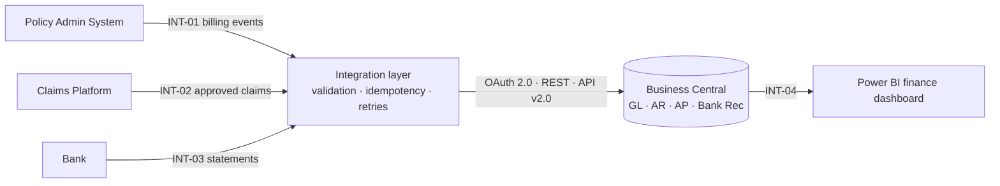

# Dynamics 365 Business Central: Insurance Finance Integration


An end-to-end **Business Analyst case study and working integration demo**. A UK insurer moves its finance system from **Dynamics NAV 2016** to **Dynamics 365 Business Central**, and its policy, claims and bank systems are integrated through the **BC standard API v2.0**.

> **Portfolio project.** *Ashgrove Mutual Insurance* is a fictional company, and all data is synthetic and generated by a script in this repo. Nothing here comes from a real client. It shows how I approach a BC implementation, from business case to tested integration code.

---

## The scenario

Ashgrove's finance team re-keys claims payments from CSV files, uploads premium summaries by hand, and reconciles the bank in Excel. Month-end close is slow, and the same person can enter and release a payment.

**The solution:** Business Central SaaS plus four integrations.



| Interface | From → To | BC objects | Key controls |
|---|---|---|---|
| **INT-01** | PAS → BC | `salesInvoices`, `salesCreditMemos` | Broker vs policyholder billing, IPT on a separate account, duplicate check |
| **INT-02** | Claims → BC | `journals/journalLines` (CLAIMS-PAY) | Validation rules, maker-checker above the authority limit, no medical data sent |
| **INT-03** | Bank → BC | Bank Account Reconciliation | Auto-match by reference, then by amount and date window; exceptions queue |
| **INT-04** | BC → Power BI | `generalLedgerEntries`, dimensions | Daily refresh, figures reconcile to the trial balance |

---

## BA deliverables (`/docs`)

| # | Document | What it covers |
|---|---|---|
| 01 | [Business case & scope](docs/01_business_case_and_scope.md) | Problem, objectives, in/out of scope, delivery approach |
| 02 | [Stakeholders & RACI](docs/02_stakeholders_raci.md) | Stakeholder map, RACI, communication plan |
| 03 | [Business requirements (BRD)](docs/03_business_requirements.md) | Functional requirements (MoSCoW), NFRs, business rules |
| 04 | [Process maps](docs/04_process_maps.md) | As-Is → To-Be for claims payments, premium billing, bank rec; gap analysis |
| 05 | [Integration specification](docs/05_integration_specification.md) | API standards, auth, field mappings, validation and error handling |
| 06 | [Data migration](docs/06_data_migration.md) | NAV → BC strategy, object mapping, CoA mapping, DQ rules, reconciliation, cutover |
| 07 | [User stories](docs/07_user_stories.md) | 9 stories with Given/When/Then acceptance criteria |
| 08 | [UAT test cases](docs/08_uat_test_cases.md) | 17 test cases, entry/exit criteria, defect severity |
| 09 | [RAID log](docs/09_raid_log.md) | Risks, assumptions, issues, dependencies |
| 10 | [Traceability matrix](docs/10_traceability_matrix.md) | Requirement → story → test → code |

---

## Integration demo (`/integration_demo`)

Python services implement INT-01 to INT-03 exactly as specified. They run against an **in-memory mock of Business Central**, so anyone can try them with no tenant or credentials. The same jobs can point at a real BC sandbox through `BusinessCentralClient`.

```bash
pip install -r requirements.txt
python integration_demo/sample_data/generate_sample_data.py   # optional, data is already included
python integration_demo/run_demo.py
python -m pytest integration_demo/tests -v
```

**Demo output**

```
INT-01  Premium billing  -> 240 invoices (gross 118,392.88), 5 credit memos, 3 duplicates skipped, 1 exceptions
INT-02  Claims payments  -> loaded 180 lines (total 365,439.85), 7 need approval, 1 duplicates skipped, 4 exceptions
INT-02  Re-run same file -> loaded 0 lines (total 0.00), 0 need approval, 181 duplicates skipped, 4 exceptions
NFR-08  No medical fields sent to Business Central: OK
INT-03  Bank matching    -> 314 matched (97%; rule 1: 289, rule 2: 25), 10 exceptions, 106 BC entries not yet on statement
```

*(The figures come from synthetic data, and the errors in it were planted on purpose so every rule gets exercised.)*

| File | Purpose |
|---|---|
| `bc_client.py` | BC API v2.0 client: OAuth 2.0 client credentials, retry with exponential backoff, dimension set lines, `Microsoft.NAV.post`. Plus `MockBusinessCentral`. |
| `premiums_to_ar.py` | INT-01: billing events → sales invoices / credit memos |
| `claims_to_gl.py` | INT-02: approved claims → journal lines, validation V01–V05, approval flag |
| `bank_reconciliation.py` | INT-03: two-rule auto-matching with exceptions |
| `config.py` | Accounts, dimensions, authority limit, retry settings, kept out of the logic |
| `tests/` | 23 automated tests mapped to the UAT cases (UAT-01 … UAT-16) |

### Connecting to a real Business Central sandbox

1. Register an app in **Microsoft Entra ID** with the API permission *Dynamics 365 Business Central → API.ReadWrite.All* (application), and grant admin consent.
2. In BC, open **Microsoft Entra Applications**, add the client ID, and assign a scoped permission set.
3. Create a general journal batch `CLAIMS-PAY`, the dimensions `PRODUCT` and `CHANNEL`, and G/L accounts 4000, 2310, 5100 and 5200.
4. Set `BC_TENANT_ID`, `BC_ENVIRONMENT`, `BC_COMPANY_ID`, `BC_CLIENT_ID` and `BC_CLIENT_SECRET`, then pass `BusinessCentralClient()` instead of the mock.

---

## Skills demonstrated

**Business analysis:** business case, stakeholder analysis, RACI, BRD with MoSCoW, As-Is/To-Be process mapping, gap analysis, user stories and acceptance criteria, UAT planning, RAID, traceability
**Dynamics 365 BC:** GL and dimensions, AR/AP, sales invoices and credit memos, general journals, approval workflows and segregation of duties, bank reconciliation, NAV → BC migration with RapidStart configuration packages
**Integration:** REST / OData API v2.0, OAuth 2.0 with Entra ID, field mapping, idempotency, retry and backoff, error handling, data minimisation (UK GDPR)
**Tools:** Python, pytest, GitHub Actions, Mermaid, Power BI (reporting design)

---

**Rushikesh Patil** · Technical Business Analyst · [GitHub](https://github.com/RushikeshPatil-BA)
