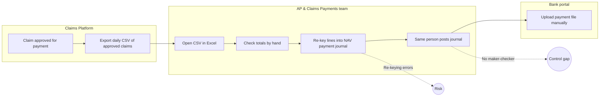
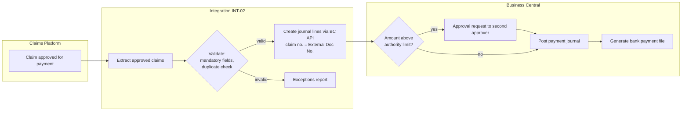
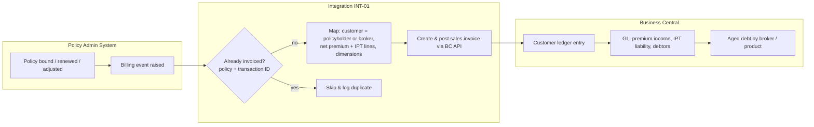
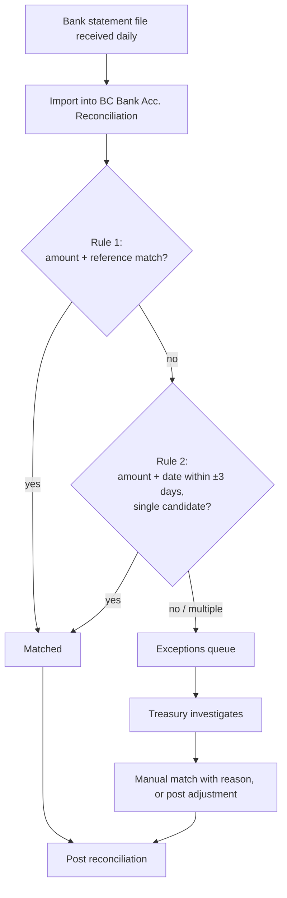

# 04 · Process Maps (As-Is → To-Be)

Diagrams are written in Mermaid, so they render directly on GitHub. They use swimlane-style subgraphs to show who does what.

---

## Process A: Claims payment to ledger

### As-Is (NAV 2016)

**Pain points:** manual re-keying, no segregation of duties, no link from GL entry back to claim number, and time-consuming reconciliation at month-end.

### To-Be (Business Central)

**Benefits:** no re-keying, maker-checker enforced in the system, full traceability from claim → journal → GL, and exceptions visible instead of lost.

---

## Process B: Premium billing to Accounts Receivable

### To-Be

---

## Process C: Bank reconciliation

### To-Be

---

## Gap analysis summary

| Area | As-Is | To-Be | Gap closed by |
|---|---|---|---|
| Claims payments | Re-keyed from CSV | API-created journal lines | INT-02 |
| Payment controls | Single user enters & posts | Approval workflow above limit, SoD | BC approvals + permission sets |
| Premium billing | Monthly summary upload | Invoice per billing event | INT-01 |
| Bank reconciliation | Excel, off-system | In BC with auto-match rules | INT-03 + matching rules |
| Reporting | Excel packs from NAV exports | Power BI on BC data, daily | INT-04 |
