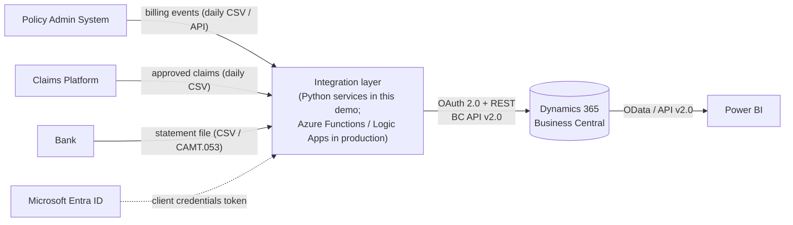
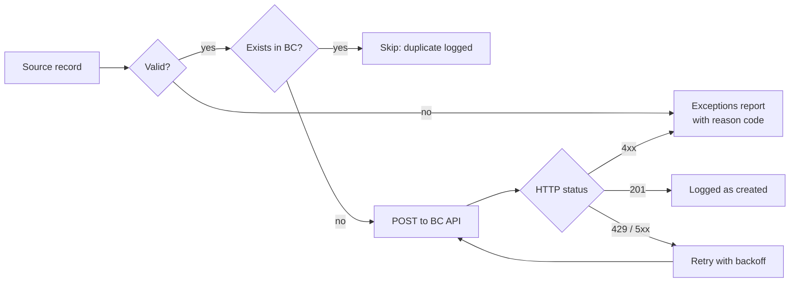

# 05 · Integration Specification

## Architecture overview

## Common standards (all interfaces)

| Topic | Standard |
|---|---|
| API | Business Central standard **API v2.0**: `https://api.businesscentral.dynamics.com/v2.0/{tenantId}/{environment}/api/v2.0/companies({companyId})/...` |
| Authentication | OAuth 2.0 client credentials flow. Entra ID app registration, scope `https://api.businesscentral.dynamics.com/.default`. The app is registered in BC as a **Microsoft Entra application** with a scoped permission set. |
| Secrets | Held in a key vault or environment variables, never in code or the repository |
| Idempotency | Before creating a record, check for an existing one with the same `externalDocumentNumber`. Skip if found. |
| Retries | HTTP 429 / 500 / 502 / 503 / 504: exponential backoff (1s, 2s, 4s, 8s, 16s), max 5 attempts |
| Errors | 4xx validation errors are not retried. The record goes to the exceptions report with the BC error message. |
| Logging | Batch ID, source record ID, BC record ID, status and timestamp for every record |
| Dates | ISO 8601 (`YYYY-MM-DD`) |
| Amounts | Decimal with 2 places. Sign convention: debit positive, credit negative on journal lines. |

---

## INT-01 · PAS → BC: Premium invoices

| | |
|---|---|
| **Direction / trigger** | PAS → BC, daily batch at 02:00 |
| **BC entity** | `salesInvoices` + `salesInvoiceLines`, then bound action `Microsoft.NAV.post` |
| **Volume** | ~300–600 billing events/day |
| **Requirements** | FR-AR-01 to FR-AR-05, BR-01 |

### Field mapping

| PAS field | BC field (salesInvoice) | Rule |
|---|---|---|
| `billing_txn_id` + `policy_number` | `externalDocumentNumber` | Format `{policy_number}-{billing_txn_id}`. Used for the duplicate check. |
| `bill_to_type`, `broker_code` / `policyholder_id` | `customerNumber` | Broker if `bill_to_type = BROKER`, else the policyholder customer |
| `billing_date` | `invoiceDate`, `postingDate` | BR-04 if the period is closed |
| `currency` | `currencyCode` | Blank for GBP (local currency) |
| `net_premium` | Line 1: G/L account 4000 Premium Income | Dimensions PRODUCT, CHANNEL |
| `ipt_amount` | Line 2: G/L account 2310 IPT Payable | BR-01 |
| `product` | Dimension PRODUCT | TRAVEL / PMI |
| `channel` | Dimension CHANNEL | DIRECT / BROKER / AFFINITY |

---

## INT-02 · Claims Platform → BC: Claim payments

| | |
|---|---|
| **Direction / trigger** | Claims → BC, daily batch at 18:00 (after the claims approval cut-off) |
| **BC entity** | `journals({id})/journalLines` in journal batch `CLAIMS-PAY` |
| **Posting** | **Not posted by the integration.** Lines above the authority limit go through the BC approval workflow. Posting is done by an approver who is a different user (FR-CP-03 / 04). |
| **Volume** | ~800–2,000 lines/day |
| **Requirements** | FR-CP-01 to FR-CP-05, BR-02, BR-03, NFR-08 |

### Field mapping

| Claims field | BC field (journalLine) | Rule |
|---|---|---|
| `claim_number` + `payment_seq` | `externalDocumentNumber` | `{claim_number}/{payment_seq}`: unique (BR-03) |
| `approved_date` | `postingDate` | BR-04 |
| `amount_paid` | `amount` | Positive (debit claims paid) |
| `product` | G/L `accountNumber` | TRAVEL → 5100 Claims Paid – Travel, PMI → 5200 Claims Paid – PMI |
| `payee_type` | `description` prefix | "Claim payment – Policyholder / Provider" |
| `batch_id` | `documentNumber` | One document number per daily batch |
| *medical details* | **not sent** | NFR-08 data minimisation |

### Validation rules (pre-load)

| Code | Check | Action |
|---|---|---|
| V01 | Mandatory fields present (claim no., amount, date, product) | Reject to exceptions |
| V02 | Amount > 0 | Reject |
| V03 | Product is a known value | Reject |
| V04 | Claim/payment_seq not already in BC | Skip as duplicate (logged) |
| V05 | Amount ≥ authority limit | Load and flag **REQUIRES_APPROVAL** |

---

## INT-03 · Bank → BC: Statement import & matching

| | |
|---|---|
| **Trigger** | Daily, on receipt of the bank statement file |
| **BC function** | Bank Account Reconciliation (statement import via data exchange definition) |
| **Matching** | Rule 1: amount + reference (claim no. / policy no. in the narrative). Rule 2: amount + date ±3 days with a single candidate. |
| **Requirements** | FR-BR-01 to FR-BR-03 |

The demo in [`/integration_demo/bank_reconciliation.py`](../integration_demo/bank_reconciliation.py) implements and tests these matching rules.

---

## INT-04 · BC → Power BI: Finance reporting

| | |
|---|---|
| **Source** | BC API v2.0 entities `generalLedgerEntries`, `dimensionSetLines`, `customers`, `salesInvoices` |
| **Refresh** | Daily, scheduled in the Power BI Service |
| **Model** | Star schema: fact GL entries; dimensions Date, Account, Product, Channel, Entity |
| **Measures** | Premium Written, Claims Paid, Loss Ratio (proxy), Cash Balance, Aged Debt |

---

## Error handling flow

